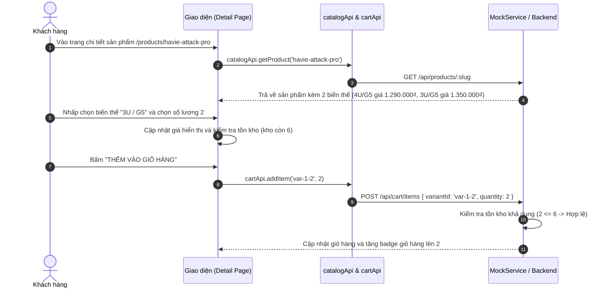
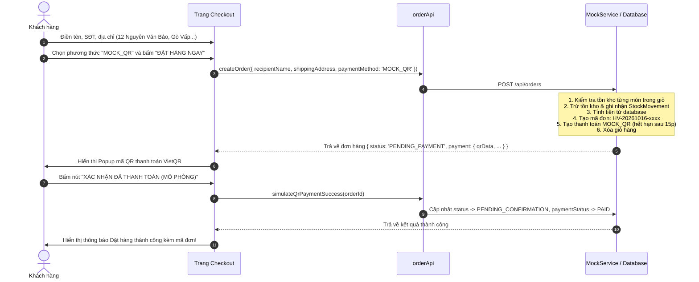
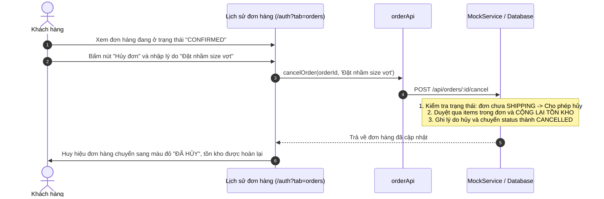
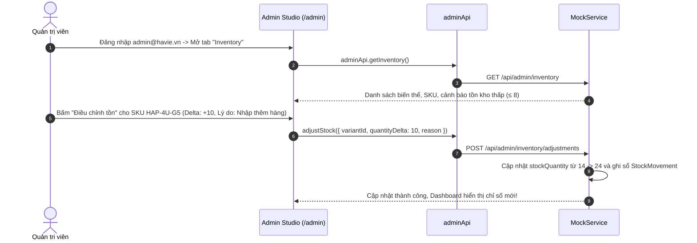

# HAVIE Badminton Store — Báo cáo kỹ thuật Commit 2
**Tích hợp & Hiện thực hóa toàn diện API Contract v1 trong React App**

---

## I. Tổng quan những công việc đã thực hiện

Trong Commit 2, toàn bộ hệ thống đã được chuyển đổi từ mô hình frontend tĩnh (dữ liệu mock thô sơ, lưu cục bộ `localStorage` không theo chuẩn) sang **kiến trúc phân tầng chuẩn hóa 100% theo tài liệu `API_CONTRACT_HAVIE_v1.md`**.

### 1. Khắc phục cấu hình dự án & Môi trường chạy
- Đã khắc phục lỗi khởi động terminal do chạy sai thư mục gốc (`ENOENT package.json`).
- Bổ sung script `"start": "vite --host 0.0.0.0"` vào [`package.json`](file:///c:/Users/LENOVO/Downloads/HAVIE/HAVIE/package.json).
- Tạo file cấu hình [`vite.config.js`](file:///c:/Users/LENOVO/Downloads/HAVIE/HAVIE/vite.config.js) tích hợp sẵn cơ chế **Reverse Proxy** `/api` chuyển tiếp tới server backend `http://localhost:3000`.

### 2. Xây dựng Kiến trúc Tầng API độc lập (`src/api/`)
Tách rời hoàn toàn logic xử lý dữ liệu khỏi giao diện React với 5 module chuyên trách:
- [`src/api/types.js`](file:///c:/Users/LENOVO/Downloads/HAVIE/HAVIE/src/api/types.js): Định nghĩa đầy đủ các Enum và nhãn hiển thị tiếng Việt (`ORDER_STATUS`, `PAYMENT_METHOD`, `PAYMENT_STATUS`, `USER_ROLES`).
- [`src/api/mockData.js`](file:///c:/Users/LENOVO/Downloads/HAVIE/HAVIE/src/api/mockData.js): Cấu trúc dữ liệu khởi tạo chuẩn hóa theo schema PostgreSQL/Prisma (Sản phẩm có biến thể `variants`, `sku`, tồn kho `stockQuantity`, tài khoản Admin và Customer mẫu, đơn hàng mẫu).
- [`src/api/mockService.js`](file:///c:/Users/LENOVO/Downloads/HAVIE/HAVIE/src/api/mockService.js): Động cơ giả lập phía client (In-Browser Contract Engine) có khả năng lưu trữ dữ liệu bền bỉ trong `localStorage`, thực thi mọi quy tắc nghiệp vụ như một Backend thật.
- [`src/api/client.js`](file:///c:/Users/LENOVO/Downloads/HAVIE/HAVIE/src/api/client.js): Bộ điều phối HTTP Client hỗ trợ cơ chế **Fallback 2 chiều** (kết nối Backend thật qua fetch hoặc tự động chuyển tiếp sang Mock Engine nếu backend chưa khởi chạy).
- [`src/api/index.js`](file:///c:/Users/LENOVO/Downloads/HAVIE/HAVIE/src/api/index.js): Cung cấp bộ SDK cấp cao gồm các domain service: `authApi`, `catalogApi`, `cartApi`, `orderApi`, `reviewApi`, `adminApi`, `addressApi`.

### 3. Nâng cấp toàn diện giao diện & nghiệp vụ React ([`src/main.jsx`](file:///c:/Users/LENOVO/Downloads/HAVIE/HAVIE/src/main.jsx))
- **Mô hình giỏ hàng mới:** Chuyển đổi từ thêm theo `product.id` sang bắt buộc chọn **`variantId`** theo đúng quy định Contract.
- **Trang Chi tiết sản phẩm ([Detail](file:///c:/Users/LENOVO/Downloads/HAVIE/HAVIE/src/main.jsx#L530)):** Thêm **Variant Picker** cho phép chọn biến thể (trọng lượng vợt `4U/3U`, size giày `40/41/42`), hiển thị giá bán và số lượng tồn kho khả dụng tức thời của từng biến thể. Hiển thị danh sách đánh giá của khách hàng.
- **Trang Thanh toán ([Checkout](file:///c:/Users/LENOVO/Downloads/HAVIE/HAVIE/src/main.jsx#L710)):** 
  - Ràng buộc đăng nhập trước khi thanh toán.
  - Nhập địa chỉ chi tiết theo cấp hành chính (Tỉnh/Thành, Quận/Huyện, Phường/Xã, Số nhà/Đường).
  - Hỗ trợ 2 phương thức thanh toán: `COD` và `MOCK_QR`.
  - Cửa sổ thanh toán QR mô phỏng (VietQR) có nút xác nhận thanh toán giả lập.
- **Trang Tài khoản & Đơn hàng ([Auth](file:///c:/Users/LENOVO/Downloads/HAVIE/HAVIE/src/main.jsx#L850)):**
  - Tích hợp 2 nút bấm đăng nhập nhanh (Quick Login) cho tài khoản Khách (`viet@example.com`) và Admin (`admin@havie.vn`).
  - Xem danh sách lịch sử đơn hàng với huy hiệu trạng thái chuẩn (`Chờ xác nhận`, `Đang giao`, `Hoàn thành`, `Đã hủy`).
  - Nút **Hủy đơn hàng** kèm bắt buộc nhập lý do (chỉ cho phép hủy trước khi đơn chuyển sang `SHIPPING`).
- **Trang Quản trị ([Admin Studio](file:///c:/Users/LENOVO/Downloads/HAVIE/HAVIE/src/main.jsx#L1020)):**
  - Bổ sung xác thực quyền `role === 'ADMIN'`.
  - **Dashboard:** Tính doanh thu thực tế từ các đơn hàng `COMPLETED` có thanh toán `PAID`, cảnh báo sản phẩm sắp hết hàng (tồn kho ≤ 8).
  - **Orders:** Xem chi tiết đơn, chuyển đổi trạng thái hợp lệ, nút **Ghi nhận thu COD**.
  - **Inventory:** Quản lý kho theo từng SKU biến thể, mở modal **Điều chỉnh tồn kho** có lưu lý do ghi sổ.
  - **Customers:** Xem danh sách khách hàng và thực hiện khóa/mở khóa tài khoản có lưu lý do.

---

## II. Code chính hoạt động như thế nào?

### 1. Sơ đồ Kiến trúc 3 tầng

```
┌─────────────────────────────────────────────────────────────┐
│                 Giao diện React (main.jsx)                  │
│       (StoreProvider, Detail, Cart, Checkout, Admin)        │
└──────────────────────────────┬──────────────────────────────┘
                               │ Gọi hàm domain (authApi, cartApi, orderApi...)
                               ▼
┌─────────────────────────────────────────────────────────────┐
│            Tầng Domain SDK (src/api/index.js)               │
│          Đóng gói Endpoint, Query Params, Payload           │
└──────────────────────────────┬──────────────────────────────┘
                               │ Gửi qua apiClient.callWithFallback(...)
                               ▼
┌─────────────────────────────────────────────────────────────┐
│          Tầng HTTP Client & Adapter (src/api/client.js)      │
│  Tự động gắn Header Authorization: Bearer <accessToken>     │
└──────────────┬───────────────────────────────┬──────────────┘
               │                               │
    (Nếu VITE_USE_MOCK=false           (Mặc định hoặc khi
       và backend đang chạy)            backend chưa khởi động)
               │                               │
               ▼                               ▼
 ┌───────────────────────────┐   ┌───────────────────────────┐
 │   Backend Server Thật     │   │  In-Browser Mock Engine   │
 │   (/api/products, v.v.)   │   │  (src/api/mockService.js) │
 │   PostgreSQL + Prisma     │   │  Lưu vào LocalStorage DB  │
 └───────────────────────────┘   └───────────────────────────┘
```

### 2. Cơ chế Fallback tại [`client.js`](file:///c:/Users/LENOVO/Downloads/HAVIE/HAVIE/src/api/client.js)
```javascript
async callWithFallback(realRequestFn, mockRequestFn) {
  if (FORCE_MOCK) {
    return await mockRequestFn(); // Đang ở chế độ Mock
  }
  try {
    return await realRequestFn(); // Gửi HTTP request thật tới /api
  } catch (networkOrHttpError) {
    // Nếu server thật chưa bật hoặc trả về lỗi kết nối (404/502) -> tự động chuyển tiếp sang Mock
    return await mockRequestFn();
  }
}
```
Nhờ cơ chế này, bạn có thể chạy song song frontend độc lập mà không bao giờ bị nghẽn (blocked) bởi tiến độ làm backend.

### 3. Quy tắc tính toán & Giao dịch tại [`mockService.js`](file:///c:/Users/LENOVO/Downloads/HAVIE/HAVIE/src/api/mockService.js)
- **Quy tắc bảo mật giá:** Khi người dùng gửi lệnh `createOrder`, request không hề chứa giá bán (`unitPrice`), tổng tiền (`totalAmount`) hay số tồn kho. MockService sẽ tự động truy vấn vào danh mục sản phẩm trong cơ sở dữ liệu, đọc giá của từng `variantId`, tính toán `subtotal`, cộng phí vận chuyển `30.000₫` và tạo đơn hàng.
- **Trừ kho nhất quán:** Nếu một biến thể không đủ số lượng trong kho, hệ thống lập tức ném lỗi `409 INSUFFICIENT_STOCK`. Nếu đủ, hệ thống đồng thời trừ `stockQuantity` và lưu lại lịch sử `stockMovements`.

---

## III. Các luồng chạy minh họa (Workflows)

### Luồng 1: Xem sản phẩm -> Chọn biến thể -> Thêm vào giỏ



---

### Luồng 2: Khách hàng Đặt hàng (Checkout) & Thanh toán



---

### Luồng 3: Khách hàng Hủy đơn hàng (Order Cancellation)



---

### Luồng 4: Thao tác của Quản trị viên (Admin Operations)



---

## IV. Những phần hiện đang được Simulated (Giả lập)

Nhằm phục vụ quá trình demo, phát triển giao diện và kiểm thử độc lập trước khi server PostgreSQL/Prisma vận hành, các thành phần sau đang được giả lập:

| Thành phần | Cơ chế giả lập hiện tại | Khi kết nối Backend thật (PostgreSQL + Prisma) |
|---|---|---|
| **Cơ sở dữ liệu (Database)** | Lưu trữ dưới dạng JSON trong `localStorage` với key `havie_api_v1_db`. Dữ liệu vẫn được giữ nguyên khi F5/refresh trang. | Dữ liệu được lưu trong PostgreSQL thông qua Prisma Client trên server Node/Express/Nest. |
| **Xác thực JWT (Token)** | Token có dạng `<userId>.mockjwt.<timestamp>` lưu tại `localStorage.getItem('havie_access_token')`. | Server thật ký JWT bằng mã bí mật (Secret Key) có thời hạn `expiresIn: 3600`. |
| **Cổng thanh toán QR (MOCK_QR)** | Hiển thị mã QR tĩnh và nút bấm giả lập việc ngân hàng quét mã thành công. | Tích hợp cổng thanh toán thật (VietQR / PayOS / VNPay) có Webhook nội bộ lắng nghe thông báo biến động số dư. |
| **Email thông báo đơn hàng** | Trạng thái hiển thị tức thì trên giao diện Lịch sử đơn hàng. | Backend sử dụng SendGrid/Nodemailer/Resend gửi email tự động tới khách hàng. |
| **Thời gian trễ mạng (Network Latency)** | Sử dụng hàm `delay(80 - 120ms)` để tạo cảm giác request mạng chân thực có hiệu ứng tải. | Thời gian phản hồi thực tế của đường truyền mạng Internet. |

---

## V. Cách kích hoạt kết nối với Backend thật 100%

Khi nhóm phát triển backend đã dựng xong API tại cổng `http://localhost:3000`:
1. Mở file [`.env`](file:///c:/Users/LENOVO/Downloads/HAVIE/HAVIE/.env) (hoặc tạo mới trong thư mục `HAVIE/`):
   ```env
   VITE_API_BASE_URL=/api
   VITE_USE_MOCK=false
   ```
2. Khởi động backend server trên cổng `3000`.
3. Chạy `npm run dev` ở frontend. File [`vite.config.js`](file:///c:/Users/LENOVO/Downloads/HAVIE/HAVIE/vite.config.js) sẽ tự động proxy mọi request `/api/*` tới backend thật mà **không cần chỉnh sửa bất kỳ dòng mã nào trong source code React!**
